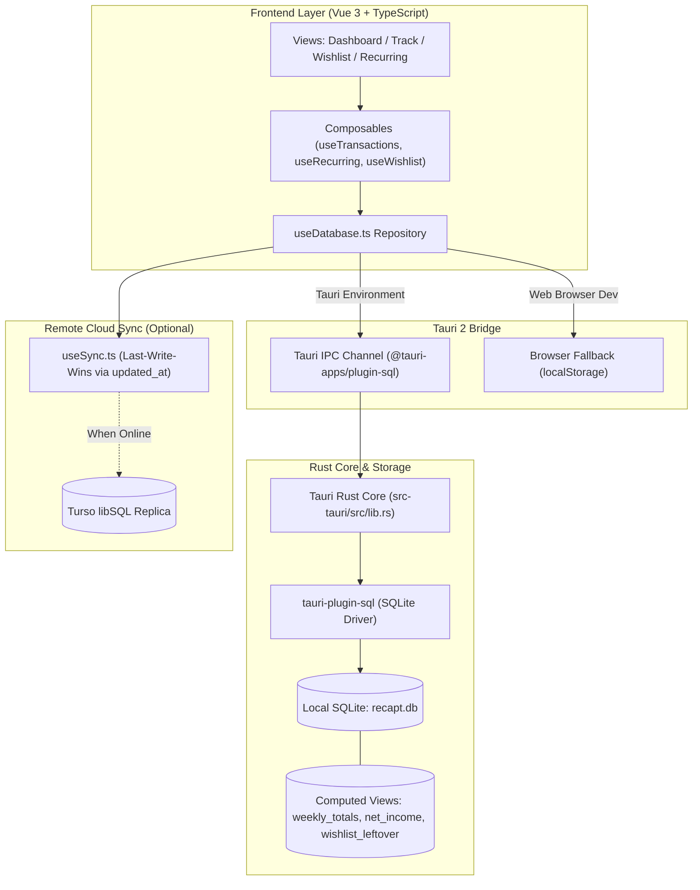
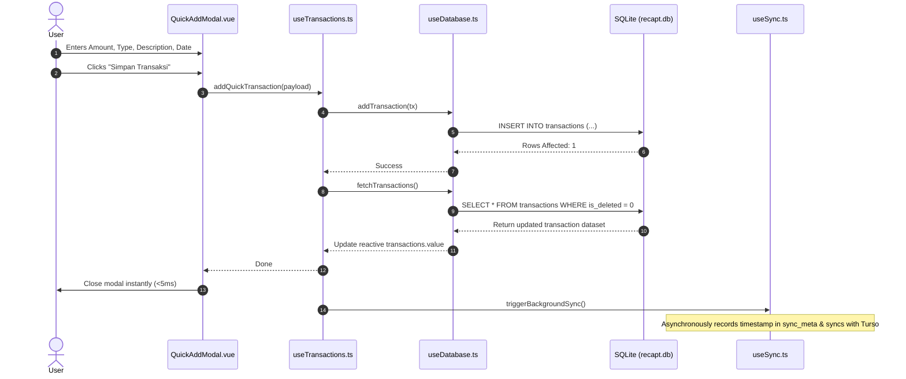

# Recapt — Personal Finance Tracker

[](https://tauri.app/)
[](https://vuejs.org/)
[](https://www.typescriptlang.org/)
[](https://tailwindcss.com/)
[](https://www.sqlite.org/)
[](https://www.rust-lang.org/)
[](https://bun.sh/)

**Recapt** is an offline-first, mobile-first personal finance tracker engineered to replace manual spreadsheets with a fast, resilient, and native experience. Built with **Tauri 2** (Rust core) and **Vue 3 + TypeScript**, Recapt compiles into lightweight native mobile apps (Android/iOS) and desktop binaries (Linux/macOS/Windows) from a single unified codebase.

All financial reads and writes execute with zero network latency directly against an embedded **SQLite** database (`recapt.db`). A non-blocking background sync layer reconciles data with a remote **Turso (libSQL embedded replicas)** database when connectivity is available, guaranteeing that the user interface never spins or stutters.

---

## Table of Contents

- [Key Features](#key-features)
- [Design Philosophy](#design-philosophy)
- [Tech Stack](#tech-stack)
- [Prerequisites](#prerequisites)
  - [General System Dependencies](#general-system-dependencies)
  - [Platform-Specific Requirements](#platform-specific-requirements)
- [Getting Started](#getting-started)
  - [1. Clone Repository](#1-clone-repository)
  - [2. Install JavaScript Dependencies](#2-install-javascript-dependencies)
  - [3. Run Browser Dev Mode (Zero Native Toolchain)](#3-run-browser-dev-mode-zero-native-toolchain)
  - [4. Run Native Desktop Dev Mode](#4-run-native-desktop-dev-mode)
  - [5. Run Android Dev Mode](#5-run-android-dev-mode)
  - [6. Database Initialization and Migrations](#6-database-initialization-and-migrations)
- [Architecture](#architecture)
  - [Directory Structure](#directory-structure)
  - [System Architecture](#system-architecture)
  - [Transaction and State Lifecycle](#transaction-and-state-lifecycle)
  - [Key Subsystems](#key-subsystems)
- [Database Schema and Views](#database-schema-and-views)
  - [Tables](#tables)
  - [Automated Schema Migrations](#automated-schema-migrations)
  - [Computed SQL Views](#computed-sql-views)
- [Environment and Configuration](#environment-and-configuration)
  - [Tauri Configuration (`tauri.conf.json`)](#tauri-configuration-tauriconfjson)
  - [Vite Configuration (`vite.config.ts`)](#vite-configuration-viteconfigts)
  - [Android Properties and Keystore](#android-properties-and-keystore)
- [Available Scripts](#available-scripts)
- [Testing and Quality Assurance](#testing-and-quality-assurance)
  - [TypeScript Verification](#typescript-verification)
  - [Rust Core Validation](#rust-core-validation)
  - [Production Bundle Dry Run](#production-bundle-dry-run)
- [Production Deployment and Packaging](#production-deployment-and-packaging)
  - [Building Desktop Installers (.deb, .AppImage, .msi, .dmg)](#building-desktop-installers-deb-appimage-msi-dmg)
  - [Building Android APK / AAB](#building-android-apk--aab)
  - [Android Keystore Signing Setup](#android-keystore-signing-setup)
- [Troubleshooting](#troubleshooting)
- [Roadmap](#roadmap)
- [License and Author](#license-and-author)

---

## Key Features

- **⚡ Sub-5-Second Quick Add**: Slide-up bottom sheet on mobile and centered modal on desktop featuring quick multiplier shortcuts (`+000`, `+0.000`, `50k`, `100k`) and keyboard-focused entry.
- **🔌 Offline-First by Architecture**: All mutations immediately persist to local SQLite (`recapt.db`). No spinners, no network blocking, and seamless offline functionality anywhere.
- **🔄 Recurring Bills and Installment Engine**: Define monthly obligations (e.g., tuition installments/UKT, PayLater, recurring subscriptions). Recapt automatically detects due rules upon launch, generates the respective ledger entries, and auto-deactivates finished installment plans.
- **🎯 Dynamic Wishlist vs. Leftover Budget**: Live balance computation (`Clean Net Income − Unbought Wishlist Items`). Visual feasibility tags indicate whether a purchase is safe (`Aman Dibelikan`), tight (`Perlu Hemat`), or exceeds your budget (`Melebihi Budget`). A single tap can convert an item to "Bought" and generate a corresponding transaction.
- **📊 Computed SQL Views**: Weekly income/expense trends and net balances are generated on read via optimized SQL views (`weekly_totals`, `net_income`, `wishlist_leftover`), eliminating manual spreadsheet formulas and drift.
- **📱 True Multiplatform Ergonomics**: Responsive layout transitioning from a frosted-glass bottom navigation bar on mobile to a fixed navigation sidebar on desktop, complete with native Android edge-to-edge window insets.
- **🌓 Institutional FinTech Design System**: High-contrast, Swiss-minimalist aesthetic utilizing Tailwind CSS v4, slate surface scales, semantic financial tints (Emerald, Rose, Blue, Amber), and persistent Dark/Light mode toggles.
- **☁️ Turso / libSQL Cloud Reconciliation**: Local SQLite syncs with Turso embedded replicas using a last-write-wins strategy based on ISO-8601 `updated_at` timestamps.

---

## Design Philosophy

Recapt adheres to an **"Institutional FinTech / Swiss Minimalist"** design philosophy:
- **Tone**: A premium, disciplined ledger resembling high-tier financial tooling rather than playful consumer apps or crypto dashboards.
- **Typography & Geometry**: Strict geometric cards (`rounded-2xl` and `rounded-3xl`), crisp borders (`border-slate-200 dark:border-slate-800`), and clean sans-serif typography (`Inter` system font stack).
- **Color Discipline**: Neutral Slate tones for structural cards and surfaces (`bg-slate-100 dark:bg-slate-950`), reserving bold colors exclusively for financial semantics:
  - **Emerald (`#10b981`)**: Income / Pemasukan
  - **Rose (`#f43f5e`)**: Outcome / Pengeluaran
  - **Blue (`#3b82f6`)**: Savings / Tabungan
  - **Amber (`#f59e0b`)**: Commitments / Recurring Bills
- **Touch Targets**: Generous mobile touch targets (minimum 44x44px), thumb-friendly bottom action buttons, and scroll clearance preventing virtual keyboard collisions.

---

## Tech Stack

| Domain | Technology | Description |
| :--- | :--- | :--- |
| **Native Core** | [Tauri v2](https://tauri.app/) | Cross-platform Rust application runtime and native shell |
| **Frontend Framework** | [Vue 3](https://vuejs.org/) (v3.5+) | Composition API, `<script setup>`, and reactive UI state |
| **Language** | [TypeScript](https://www.typescriptlang.org/) (v5.6+) | End-to-end typed interfaces matching the database schema |
| **Styling & CSS** | [Tailwind CSS v4](https://tailwindcss.com/) | Next-generation utility engine via `@tailwindcss/vite` |
| **Build & Tooling** | [Vite 6](https://vitejs.dev/) + [Bun](https://bun.sh/) | Fast bundling, HMR, and ultra-fast package management |
| **Local Database** | [SQLite](https://www.sqlite.org/) | Embedded database handled via `@tauri-apps/plugin-sql` |
| **Remote Database** | [Turso / libSQL](https://turso.tech/) | Cloud replication target with embedded replica support |
| **Iconography** | [Lucide Vue Next](https://lucide.dev/) | Clean, stroke-based iconography |
| **Target OS** | Android, Linux, macOS, Windows | Native mobile and desktop packaging |

---

## Prerequisites

### General System Dependencies

- **[Bun](https://bun.sh/)** (version 1.0 or higher recommended) or **Node.js** (v20+ with npm/pnpm).
- **[Rust Toolchain](https://www.rust-lang.org/tools/install)**: `rustc` and `cargo` (stable channel).
  ```bash
  curl --proto '=https' --tlsv1.2 -sSf https://sh.rustup.rs | sh
  rustc --version
  ```
- **Tauri CLI v2**:
  ```bash
  cargo install tauri-cli --version "^2.0" --locked
  ```

---

### Platform-Specific Requirements

#### 🐧 Linux (Ubuntu / Debian)
Tauri requires system packages for WebKitGTK and native windowing:
```bash
sudo apt update
sudo apt install -y \
  libwebkit2gtk-4.1-dev \
  build-essential \
  curl \
  wget \
  file \
  libxdo-dev \
  libssl-dev \
  libayatana-appindicator3-dev \
  librsvg2-dev
```

#### 🍏 macOS
- Install **Xcode** and Xcode Command Line Tools:
  ```bash
  xcode-select --install
  ```

#### 🪟 Windows
- **Microsoft Visual Studio 2022** with the "Desktop development with C++" workload.
- **WebView2** runtime (pre-installed on Windows 10/11).

#### 🤖 Android (Mobile Build)
1. Install **[Android Studio](https://developer.android.com/studio)**.
2. In Android Studio SDK Manager, install:
   - **Android SDK Platform 34** (or higher)
   - **Android SDK Build-Tools**
   - **Android NDK (Side by side)** (version 26+ recommended)
   - **Android SDK Command-line Tools (latest)**
   - **CMake**
3. Configure environment variables in your shell profile (`~/.bashrc`, `~/.zshrc`):
   ```bash
   export ANDROID_HOME="$HOME/Android/Sdk"
   export NDK_HOME="$ANDROID_HOME/ndk/<installed_ndk_version>"
   export PATH="$PATH:$ANDROID_HOME/platform-tools:$ANDROID_HOME/cmdline-tools/latest/bin"
   ```
4. Install Rust targets for Android ABIs:
   ```bash
   rustup target add aarch64-linux-android armv7-linux-androideabi i686-linux-android x86_64-linux-android
   ```

---

## Getting Started

### 1. Clone Repository

```bash
git clone https://github.com/rafia9005/finance-track.git
cd finance-track
```

### 2. Install JavaScript Dependencies

This project is configured with `bun.lock`. Run:
```bash
bun install
```
*(If Bun is not available on your system, `npm install` or `pnpm install` will also work).*

### 3. Run Browser Dev Mode (Zero Native Toolchain)

Recapt includes a built-in browser fallback engine in `src/composables/useDatabase.ts`. When run in an ordinary web browser outside the Tauri shell, Recapt automatically falls back to reactive `localStorage` persistence. This enables rapid UI development and prototyping without compiling Rust:

```bash
bun run dev
```
Open **[http://localhost:1420](http://localhost:1420)** in any modern web browser.

### 4. Run Native Desktop Dev Mode

To launch the application inside the full Tauri native desktop container with the embedded SQLite engine:

```bash
bun run tauri dev
```
This triggers:
1. Vite dev server on `http://localhost:1420`.
2. Cargo build of `src-tauri` in debug mode.
3. Spawns the native OS window running SQLite database migrations (`recapt.db`).

### 5. Run Android Dev Mode

Connect your Android device via USB with USB Debugging enabled, or launch an Android Virtual Device (AVD) emulator:

```bash
# Check detected Android devices
adb devices

# Start Tauri Android development
bun run tauri android dev
```

Tauri compiles the Rust native libraries (`.so`) for your device architecture, builds the Kotlin Android shell (`src-tauri/gen/android`), installs the debug APK, and streams logcat outputs directly to your terminal.

### 6. Database Initialization and Migrations

When running in the Tauri runtime (desktop or mobile), the SQLite database (`recapt.db`) is automatically initialized by the `tauri_plugin_sql` builder during app startup. Migration `01_initial_schema.sql` creates all tables and views idempotently (`CREATE TABLE IF NOT EXISTS` and `CREATE VIEW IF NOT EXISTS`).

On Linux/macOS/Windows, the SQLite database is located in the application data directory:
- **Linux**: `~/.local/share/com.rafia.finance-track/recapt.db`
- **macOS**: `~/Library/Application Support/com.rafia.finance-track/recapt.db`
- **Windows**: `C:\Users\<User>\AppData\Roaming\com.rafia.finance-track\recapt.db`
- **Android**: `/data/data/com.rafia.finance_track/databases/recapt.db`

---

## Architecture

### Directory Structure

```
finance-track/
├── src/                               # Frontend Webview Application (Vue 3 + TS)
│   ├── assets/
│   │   └── main.css                   # Tailwind CSS v4 entrypoint & dark mode variant
│   ├── components/
│   │   ├── dashboard/                 # Dashboard view components
│   │   │   ├── AnalyticsSection.vue   # Weekly trend progress bars & category breakdown
│   │   │   ├── DashboardView.vue      # Primary dashboard tab container
│   │   │   ├── HeroNetIncome.vue      # High-contrast Net Income hero block
│   │   │   └── RecentLedger.vue       # Recent transactions summary list
│   │   ├── layout/                    # Responsive navigation shells
│   │   │   ├── AppLayout.vue          # Main layout container & theme management
│   │   │   ├── BottomNav.vue          # Frosted-glass mobile bottom navigation + FAB
│   │   │   └── SidebarNav.vue         # Persistent desktop left sidebar (w-64)
│   │   ├── recurring/                 # Recurring bills & installments
│   │   │   ├── RecurringCard.vue      # Individual recurring bill card
│   │   │   └── RecurringView.vue      # Template manager & monthly commitment summary
│   │   ├── transactions/              # Core ledger tracking & transaction entry
│   │   │   ├── QuickAddModal.vue      # <5s Fast Add slide-up sheet / dialog
│   │   │   ├── TrackView.vue          # Full ledger with search & type filter pills
│   │   │   ├── TransactionItem.vue    # Individual transaction row with soft-delete
│   │   │   └── TransactionList.vue    # Date-grouped transaction container
│   │   └── wishlist/                  # Wishlist & budget checking
│   │       ├── WishlistItem.vue       # Wishlist item row with bought toggle
│   │       └── WishlistView.vue       # Leftover budget calculator & item list
│   ├── composables/                   # Reactive state & business logic
│   │   ├── useDatabase.ts             # SQLite repository + browser localStorage fallback
│   │   ├── useRecurring.ts            # Auto-debit generation engine
│   │   ├── useSync.ts                 # Background sync trigger & online state
│   │   ├── useTransactions.ts         # Ledger queries, filters & grouping
│   │   └── useWishlist.ts             # Dynamic budget feasibility logic
│   ├── types/
│   │   └── database.ts                # TypeScript interfaces for schema & SQL views
│   ├── utils/
│   │   ├── currency.ts                # Indonesian Rupiah (IDR) formatters
│   │   └── date.ts                    # ISO dates, relative labels & ISO week utilities
│   ├── App.vue                        # Root view router & life-cycle triggers
│   ├── main.ts                        # Vue application entry point
│   └── vite-env.d.ts                  # Vite & Tauri client type definitions
│
├── src-tauri/                         # Rust Native Core (Tauri 2 backend)
│   ├── capabilities/
│   │   └── default.json               # Window security capabilities & plugin permissions
│   ├── gen/
│   │   └── android/                   # Generated Gradle / Kotlin Android project
│   │       └── app/src/main/java/.../
│   │           └── MainActivity.kt    # Android edge-to-edge window insets handler
│   ├── icons/                         # Multiplatform app icons (Android, macOS, Win, Linux)
│   ├── migrations/
│   │   └── 01_initial_schema.sql      # Idempotent SQLite schema & computed views
│   ├── src/
│   │   ├── lib.rs                     # Tauri plugin initialization (SQL, Opener)
│   │   └── main.rs                    # Native entry point
│   ├── Cargo.toml                     # Rust dependencies & crate definitions
│   └── tauri.conf.json                # Tauri v2 configuration (identifier, build, windows)
│
├── CHANGELOG.md                       # Semantic versioning release log
├── DESIGN.md                          # Institutional FinTech UI/UX design specifications
├── PLAN.md                            # Multi-phase implementation roadmap
├── PRD.md                             # Product Requirements Document
├── SCHEMA.md                          # Detailed SQLite database schema & sync architecture
├── bun.lock                           # Bun lockfile
├── package.json                       # Scripts and frontend dependencies
├── tsconfig.json                      # TypeScript configuration
└── vite.config.ts                     # Vite + Tailwind CSS v4 bundler configuration
```

---

### System Architecture



---

### Transaction and State Lifecycle



---

### Key Subsystems

#### 1. Dual-Mode Storage Engine (`src/composables/useDatabase.ts`)
The database repository abstracts all data access behind a uniform asynchronous API:
- **Native Tauri Context**: Connects to `sqlite:recapt.db` via `@tauri-apps/plugin-sql`. Queries execute in native Rust threads with parameterized SQL inputs.
- **Browser Context**: If the Tauri runtime is not detected, `useDatabase` transparently persists data to browser `localStorage`. This allows instant testing, styling, and debugging in Chrome, Firefox, or Safari without a Rust compiler.

#### 2. Core Transaction Ledger & Fast Add (`src/components/transactions/`)
- Designed to complete data entry in under 5 seconds.
- Multiplier chips (`+000`, `+0.000`, `50k`, `100k`) allow entering amounts in Indonesian Rupiah with single taps.
- Supports real-time text searching across descriptions and categories, filter pills (`Semua`, `Pengeluaran`, `Pemasukan`, `Tabungan`), and chronological grouping by date with humanized headers ("Hari ini", "Kemarin").
- Implements soft deletes (`is_deleted = 1`) to preserve audit trails for multi-device sync.

#### 3. Recurring Bills & Auto-Debit Engine (`src/composables/useRecurring.ts`)
- Manages fixed monthly commitments (rent, tuition/UKT, subscriptions, PayLater).
- Upon app launch or tab access, `checkAndGenerateRecurringTransactions()` evaluates active templates where today's day of the month meets or exceeds `day_of_month`.
- Idempotent: checks whether an entry for the template was already generated in the current calendar month.
- Auto-deactivates installment templates once `installments_paid == total_installments`.

#### 4. Dynamic Wishlist & Budget Checking (`src/composables/useWishlist.ts`)
- Evaluates your unbought wishlist total against your clean net income (`net_income - unbought_wishlist_sum`).
- Provides real-time financial feasibility ratings:
  - `Aman Dibelikan`: Surplus budget covers all items.
  - `Perlu Hemat`: Deficit is under Rp 1.000.000.
  - `Melebihi Budget`: Deficit exceeds Rp 1.000.000.
- Marking an item as "Bought" offers a one-tap option to create an associated `outcome` ledger entry linked via `wishlist_item_id`.

#### 5. Android Insets and Edge-to-Edge System Bars (`MainActivity.kt`)
On modern Android devices (Android 14/15+ edge-to-edge), webviews can be obscured by status bars and gesture navigation bars. Recapt overrides `MainActivity.kt` with `ViewCompat.setOnApplyWindowInsetsListener`:
```kotlin
ViewCompat.setOnApplyWindowInsetsListener(findViewById(android.R.id.content)) { view, insets ->
    val bars = insets.getInsets(WindowInsetsCompat.Type.systemBars())
    view.setPadding(bars.left, bars.top, bars.right, bars.bottom)
    insets
}
```
This guarantees that top headers and bottom navigation buttons stay within the interactive viewport.

---

## Database Schema and Views

All amounts are stored as **positive integers in Indonesian Rupiah** (no floating point rounding issues). Timestamps use standard ISO-8601 formatting (`YYYY-MM-DD` for dates, `YYYY-MM-DDTHH:MM:SSZ` for timestamps).

### Tables

#### `transactions`
Core financial ledger storing every income, expense, and savings event.
```sql
CREATE TABLE IF NOT EXISTS transactions (
    id                    TEXT PRIMARY KEY,
    date                  TEXT NOT NULL,          -- YYYY-MM-DD
    type                  TEXT NOT NULL CHECK (type IN ('income', 'outcome', 'saving')),
    description           TEXT NOT NULL,
    amount                INTEGER NOT NULL,       -- Rupiah, positive integer
    category              TEXT,                   -- e.g., 'Makanan', 'Gaji', 'Tagihan'
    recurring_template_id TEXT,                   -- References recurring_templates(id)
    wishlist_item_id      TEXT,                   -- References wishlist_items(id)
    created_at            TEXT NOT NULL,          -- ISO-8601
    updated_at            TEXT NOT NULL,          -- ISO-8601
    is_deleted            INTEGER NOT NULL DEFAULT 0
);

CREATE INDEX IF NOT EXISTS idx_transactions_date ON transactions(date);
CREATE INDEX IF NOT EXISTS idx_transactions_type ON transactions(type);
```

#### `recurring_templates`
Schedules automated bill and installment generation.
```sql
CREATE TABLE IF NOT EXISTS recurring_templates (
    id                  TEXT PRIMARY KEY,
    description         TEXT NOT NULL,
    amount              INTEGER NOT NULL,
    type                TEXT NOT NULL CHECK (type IN ('income', 'outcome', 'saving')),
    category            TEXT,
    day_of_month        INTEGER NOT NULL CHECK (day_of_month BETWEEN 1 AND 31),
    start_date          TEXT NOT NULL,           -- YYYY-MM-DD
    total_installments  INTEGER,                 -- NULL = indefinite subscription
    installments_paid   INTEGER NOT NULL DEFAULT 0,
    active              INTEGER NOT NULL DEFAULT 1,
    created_at          TEXT NOT NULL,
    updated_at          TEXT NOT NULL,
    is_deleted          INTEGER NOT NULL DEFAULT 0
);
```

#### `wishlist_items`
Tracks desired purchases and targets.
```sql
CREATE TABLE IF NOT EXISTS wishlist_items (
    id          TEXT PRIMARY KEY,
    name        TEXT NOT NULL,
    price       INTEGER NOT NULL,
    bought      INTEGER NOT NULL DEFAULT 0,      -- 0 = wanted, 1 = purchased
    created_at  TEXT NOT NULL,
    updated_at  TEXT NOT NULL,
    is_deleted  INTEGER NOT NULL DEFAULT 0
);
```

#### `sync_meta`
Local-only metadata table tracking replication timestamps.
```sql
CREATE TABLE IF NOT EXISTS sync_meta (
    key         TEXT PRIMARY KEY,                -- e.g., 'last_synced_at'
    value       TEXT NOT NULL,
    updated_at  TEXT NOT NULL
);
```

---

### Automated Schema Migrations

Migrations are configured in `src-tauri/src/lib.rs` and loaded from `src-tauri/migrations/01_initial_schema.sql`:

```rust
let migrations = vec![
    Migration {
        version: 1,
        description: "create_initial_schema",
        sql: include_str!("../migrations/01_initial_schema.sql"),
        kind: MigrationKind::Up,
    }
];

tauri::Builder::default()
    .plugin(tauri_plugin_opener::init())
    .plugin(
        tauri_plugin_sql::Builder::default()
            .add_migrations("sqlite:recapt.db", migrations)
            .build(),
    )
    .run(tauri::generate_context!())
    .expect("error while running tauri application");
```

---

### Computed SQL Views

Instead of maintaining brittle stored aggregate columns, Recapt derives analytics dynamically:

#### 1. Weekly Totals (`weekly_totals`)
Aggregates income, outcome, and savings grouped by ISO week (`YYYY-Www`):
```sql
CREATE VIEW IF NOT EXISTS weekly_totals AS
SELECT
    strftime('%Y-W%W', date) AS week,
    SUM(CASE WHEN type = 'income'  THEN amount ELSE 0 END) AS income,
    SUM(CASE WHEN type = 'outcome' THEN amount ELSE 0 END) AS outcome,
    SUM(CASE WHEN type = 'saving'  THEN amount ELSE 0 END) AS saving
FROM transactions
WHERE is_deleted = 0
GROUP BY week;
```

#### 2. Net Income (`net_income`)
Computes all-time clean net income (`Total Income - Total Outcome - Total Savings`):
```sql
CREATE VIEW IF NOT EXISTS net_income AS
SELECT
    SUM(CASE WHEN type = 'income'  THEN amount ELSE 0 END)
  - SUM(CASE WHEN type = 'outcome' THEN amount ELSE 0 END)
  - SUM(CASE WHEN type = 'saving'  THEN amount ELSE 0 END) AS net
FROM transactions
WHERE is_deleted = 0;
```

#### 3. Wishlist Leftover (`wishlist_leftover`)
Calculates remaining budget after factoring in unbought wishlist items:
```sql
CREATE VIEW IF NOT EXISTS wishlist_leftover AS
SELECT
    (SELECT COALESCE(net, 0) FROM net_income) -
    (SELECT COALESCE(SUM(price), 0) FROM wishlist_items WHERE bought = 0 AND is_deleted = 0) AS leftover;
```

---

## Environment and Configuration

### Tauri Configuration (`tauri.conf.json`)

Key settings in `src-tauri/tauri.conf.json`:
- **Identifier**: `com.rafia.finance-track` (must be unique for OS app registries).
- **Frontend Distribution**: `"../dist"` (target directory compiled by `vite build`).
- **Dev URL**: `"http://localhost:1420"`.
- **Pre-command**: Runs `bun run build` before packaging.

### Vite Configuration (`vite.config.ts`)

- **Host Binding**: Supports mobile device debugging over LAN when `TAURI_DEV_HOST` is supplied.
- **Port**: Fixed to `1420` (HMR on `1421`).
- **File Watching**: Configured to ignore `src-tauri/` to prevent infinite rebuild loops.

```typescript
import { defineConfig } from "vite";
import vue from "@vitejs/plugin-vue";
import tailwindcss from "@tailwindcss/vite";

const host = process.env.TAURI_DEV_HOST;

export default defineConfig(async () => ({
  plugins: [vue(), tailwindcss()],
  server: {
    port: 1420,
    strictPort: true,
    host: host || false,
    hmr: host ? { protocol: "ws", host, port: 1421 } : undefined,
    watch: {
      ignored: ["**/src-tauri/**"],
    },
  },
}));
```

### Android Properties and Keystore

For release builds on Android, configuration is maintained in `src-tauri/gen/android/keystore.properties`:
```properties
password=your_keystore_password
keyPassword=your_key_password
keyAlias=your_key_alias
storeFile=path/to/upload-keystore.jks
```

---

## Available Scripts

| Command | Purpose |
| :--- | :--- |
| `bun run dev` | Starts Vite dev server for browser preview (using localStorage fallback) |
| `bun run build` | Runs `vue-tsc --noEmit` typecheck and compiles production web assets into `dist/` |
| `bun run preview` | Previews the compiled `dist/` production assets in browser |
| `bun run tauri dev` | Launches full Tauri desktop development application with SQLite |
| `bun run tauri build` | Packages production native desktop installers (`.deb`, `.AppImage`, etc.) |
| `bun run tauri android init` | Re-generates or initializes the Android native project in `src-tauri/gen/android` |
| `bun run tauri android dev` | Deploys and live-reloads the application on an Android device or emulator |
| `bun run tauri android build` | Builds release Android APK / AAB artifacts |

---

## Testing and Quality Assurance

### TypeScript Verification

Verify complete static typing across all components, composables, and utilities:
```bash
bun x vue-tsc --noEmit
```

### Rust Core Validation

Run Cargo diagnostics, lints, and unit tests inside `src-tauri`:
```bash
# Verify Rust compilation and dependencies
cargo check --manifest-path src-tauri/Cargo.toml

# Run linter
cargo clippy --manifest-path src-tauri/Cargo.toml

# Execute Rust test suite
cargo test --manifest-path src-tauri/Cargo.toml
```

### Production Bundle Dry Run

Test asset compilation and bundling:
```bash
bun run build
```
Expected output:
```
✓ 1766 modules transformed.
dist/index.html                   0.48 kB │ gzip:  0.31 kB
dist/assets/index-DtHIYdEi.css   41.86 kB │ gzip:  7.33 kB
dist/assets/index-Bcl-BNaz.js   142.32 kB │ gzip: 43.80 kB
✓ built in ~1.5s
```

---

## Production Deployment and Packaging

### Building Desktop Installers (.deb, .AppImage, .msi, .dmg)

To produce production desktop packages for your current operating system:
```bash
bun run tauri build
```
Artifacts are generated in `src-tauri/target/release/bundle/`:
- **Linux**: `.deb` package and standalone `.AppImage`
- **macOS**: `.dmg` installer and `.app` bundle
- **Windows**: `.msi` Windows Installer and `.exe` NSIS setup

### Building Android APK / AAB

#### Standalone Universal APK
```bash
bun run tauri android build --apk
```
The compiled APK will be located at:
```
src-tauri/gen/android/app/build/outputs/apk/release/app-release-unsigned.apk
```

#### Google Play Android App Bundle (AAB)
```bash
bun run tauri android build --aab
```
The compiled AAB will be located at:
```
src-tauri/gen/android/app/build/outputs/bundle/release/app-release.aab
```

### Android Keystore Signing Setup

To sign the APK for distribution or Google Play Store:
1. Generate an upload keystore:
   ```bash
   keytool -genkey -v -keystore upload-keystore.jks \
     -alias recapt-key -keyalg RSA -keysize 2048 -validity 10000
   ```
2. Create `src-tauri/gen/android/keystore.properties`:
   ```properties
   storePassword=YOUR_STORE_PASSWORD
   keyPassword=YOUR_KEY_PASSWORD
   keyAlias=recapt-key
   storeFile=../../../upload-keystore.jks
   ```
3. Re-run `bun run tauri android build --apk`. Gradle will sign the binary automatically.

---

## Troubleshooting

### 1. `libwebkit2gtk-4.1` Missing on Linux
**Symptom**: `pkg-config` errors during `cargo build` stating `webkit2gtk-4.1` could not be found.  
**Resolution**:
```bash
sudo apt install -y libwebkit2gtk-4.1-dev libssl-dev libayatana-appindicator3-dev
```

### 2. Android SDK / NDK Path Not Recognized
**Symptom**: `Tauri was not able to find the Android SDK or NDK`.  
**Resolution**: Ensure `ANDROID_HOME` and `NDK_HOME` are exported in your active shell:
```bash
export ANDROID_HOME="$HOME/Android/Sdk"
export NDK_HOME="$ANDROID_HOME/ndk/$(ls $ANDROID_HOME/ndk | sort -V | tail -n 1)"
export PATH="$PATH:$ANDROID_HOME/platform-tools:$ANDROID_HOME/cmdline-tools/latest/bin"
```

### 3. Tauri SQL Plugin Returns `Database Unavailable`
**Symptom**: When loading the app in a regular web browser, console warns about missing plugin.  
**Resolution**: This is expected behavior. The app automatically activates the localStorage fallback in `src/composables/useDatabase.ts`. If you intended to run with native SQLite, run `bun run tauri dev` rather than `bun run dev`.

### 4. Mobile Keyboard Overflows Modal Inputs
**Symptom**: Virtual keyboard pushes amount or category inputs offscreen.  
**Resolution**: Modals in Recapt are bounded by `max-h-[88vh] overflow-y-auto` and quick multiplier tags are set to `flex-wrap` to adjust dynamically to reduced viewport heights.

### 5. Dark Mode Not Applying
**Symptom**: Dark theme classes do not apply correctly when toggled.  
**Resolution**: Tailwind CSS v4 requires the custom variant `@custom-variant dark (&:where(.dark, .dark *));` in `src/assets/main.css`. Ensure `main.css` includes this directive.

---

## Roadmap

- [x] Core transaction tracking with sub-5-second quick add.
- [x] Local-first SQLite database with automatic migrations (`recapt.db`).
- [x] Auto-generation engine for recurring bills and installments.
- [x] Dynamic wishlist budget feasibility calculator.
- [x] Institutional FinTech / Swiss Minimalist responsive UI (mobile bottom nav + desktop sidebar).
- [x] Android edge-to-edge window insets padding.
- [x] Browser `localStorage` fallback for rapid frontend development.
- [ ] Active two-way sync with Turso cloud libSQL embedded replicas.
- [ ] Biometric / passcode lock option for personal security.
- [ ] CSV/Excel transaction export and import utilities.

---

## License and Author

Created and maintained by **RafiAthallahN** ([@RafiAthallahN](https://github.com/RafiAthallahN)).  
Licensed under the [MIT License](LICENSE).
